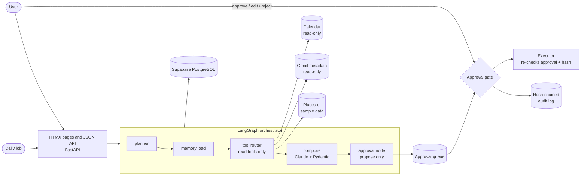

# Executive Assistant Agent

A personal and executive assistant that plans your day, shortlists restaurants and drafts messages.
It reads your calendar and email on its own. **Anything that sends, books or pays waits in an approval
queue until you approve it**, and every step is written to a tamper-evident audit log.

Built with LangGraph, Claude, FastAPI and Supabase (PostgreSQL). Runs fully on fictional sample data
with no accounts and no API keys, so you can try the whole flow in two minutes.

> Live demo: added here once the deployment is verified.

## What it does

| Flow | What happens | Writes? |
|---|---|---|
| **Morning briefing** | Reads today's calendar and recent mail. Flags overlaps, back-to-back meetings and overloaded days. Ranks priority mail. Finds focus windows. | None. Read only. |
| **Plan a dinner** | Finds free evening slots, shortlists three restaurants, drafts a message to your friend, prepares a booking. | Proposes `send_message` and `book_table`. Both wait for you. |

Try it in the chat: `Plan dinner with Sam on Friday` or `Give me my morning briefing`.

## The core rule

```
reads  -> run automatically
sends / books / pays -> propose -> approval queue -> YOU approve -> execute once -> audit log
```

How the rule is enforced, not just promised:

1. **The agent has no write tools.** The tool registry runs read tools only. Calling `send_message`,
   `book_table` or `pay` directly raises an error and is logged.
2. **One path to a side effect.** `ApprovalGate.approve()` is the only code that reaches the executor.
3. **The executor checks again.** Before doing anything it re-reads the recorded approval from the
   database and re-checks the payload hash. A missing approval or a changed payload is refused.
4. **Approvals are idempotent.** A unique constraint on the approval row means double clicks, retries
   and concurrent requests execute exactly once.
5. **Proposals expire.** Unapproved actions lapse after 24 hours (configurable).
6. **Untrusted text cannot steer it.** The model only returns validated structured data. Email and
   listing text is treated as data. Mail that reads like instructions to an AI is flagged and ignored.
7. **The audit log is hash-chained.** Editing or deleting an entry breaks the chain, and the UI shows it.

## Architecture



| Layer | Choice |
|---|---|
| Orchestration | LangGraph: planner, memory, tool router, compose, approval |
| Model | Claude with a forced tool call, validated by Pydantic, retried on invalid output |
| Facts vs prose | Conflicts, free slots and rankings are computed in Python. The model writes prose and its output is checked against those facts. |
| API and UI | FastAPI, Jinja2 and HTMX (vendored, no CDN, no JavaScript build) |
| Data | Supabase / PostgreSQL, with an in-memory store for local runs |
| Tools | Google Calendar and Gmail (read-only scopes), Places search, or built-in sample data |
| Deploy | Docker on Railway |

## Run it locally (no accounts, no keys)

```bash
python -m venv .venv && source .venv/bin/activate      # Windows: .venv\Scripts\activate
pip install -r requirements-dev.txt
uvicorn app.main:app --reload
# open http://localhost:8000
```

With no `ANTHROPIC_API_KEY` a deterministic built-in model is used, so the demo and the tests work
offline. Add a key and the same code path calls Claude.

```bash
python -m pytest                      # 119 tests, in-memory store
TEST_DATABASE_URL=postgresql://... python -m pytest     # also runs the suite against PostgreSQL (168 pass, 3 store-specific skips)
python scripts/measure.py --runs 30   # measured latency, approval coverage, test count
```

## Configuration

Everything is an environment variable. See `.env.example` for the full list.

| Variable | Purpose |
|---|---|
| `ACCESS_TOKEN` | Private mode. Login required, single user, real data allowed. |
| `ALLOW_PUBLIC_DEMO` | Demo mode. No login, sample data only, one sandbox per visitor, deleted after 24 hours. |
| `DATA_MODE` | `sample` (default) or `google` (your own read-only calendar and mail). |
| `ANTHROPIC_API_KEY`, `CLAUDE_MODEL` | Use Claude instead of the built-in mock. |
| `DATABASE_URL` | Supabase / PostgreSQL. Empty means in-memory. The schema is applied on start. |
| `TABLE_PREFIX` | Optional. Prefix for every table and index, so several projects can share one database. |
| `TOKEN_ENCRYPTION_KEY` | Fernet key that encrypts stored OAuth tokens. Required in production. |
| `CRON_TOKEN` | Lets a scheduled job call `POST /api/jobs/briefing`. |

Production refuses to start without either `ACCESS_TOKEN` or `ALLOW_PUBLIC_DEMO=true`, and without
`TOKEN_ENCRYPTION_KEY`.

## API

Interactive docs are served at `/docs`. Main endpoints:

| Method and path | Purpose |
|---|---|
| `GET /health` | Health and dependency check |
| `POST /api/chat` | Ask for a briefing or a dinner plan |
| `POST /api/briefing/run` | Run the morning briefing now |
| `GET /api/approvals?status=pending` | The approval queue |
| `POST /api/approvals/{id}/approve` | Approve (optionally with `edited_text` for a message) |
| `POST /api/approvals/{id}/reject` | Reject |
| `POST /api/dinner/{plan_id}/choose` | Switch to another shortlisted restaurant |
| `GET /api/audit` | Audit log and chain verification |
| `GET /api/me/data`, `DELETE /api/me/data` | Export or delete everything stored about you |
| `POST /api/jobs/briefing` | Scheduled briefing, once per day, token protected |

## Privacy

Minimum data, documented, deletable. See [docs/DATA_AND_PRIVACY.md](docs/DATA_AND_PRIVACY.md).
Gmail is read as metadata only (sender, subject, date, snippet). Bodies and attachments are never
requested. Refresh tokens are encrypted before they are stored. One call exports your data and one
call deletes it.

## More documentation

- [Threat model](docs/THREAT_MODEL.md): what can go wrong and which test proves each defense
- [Google setup](docs/GOOGLE_SETUP.md): connect your own calendar and mail, read-only
- [Deploy to Railway](docs/DEPLOY_RAILWAY.md): Supabase, environment, domain and cron
- [Front-door readiness](docs/FRONT_DOOR_READINESS.md): how each action maps to Apple App Intents and to Android assistant hooks (design note, no code)
- [Case study](docs/case_study.md): measured results

## Known limits

- Send, book and pay are **simulated stubs**. They write to an outbox table. Replace the body of one
  function in `app/executors.py` to connect a real channel. The approval guard stays in front of it.
- Live Google and Places behavior needs your own credentials. The request shapes and parsing are
  tested against mocked responses, not a live account.
- If the process dies after an approval is recorded but before the action runs, that action stays
  pending until it expires. It is never run twice.
- Single-user in private mode. Multi-tenant roles are out of scope.

## Phase 2 ideas

Not built, on purpose:

- Real send and booking integrations behind the existing gate
- Push delivery of the briefing to a chat app
- Voice input and a Siri / App Intents client
- Retry button for failed actions
- Per-user roles and team assistants
- Learning preferences from approved and rejected proposals
